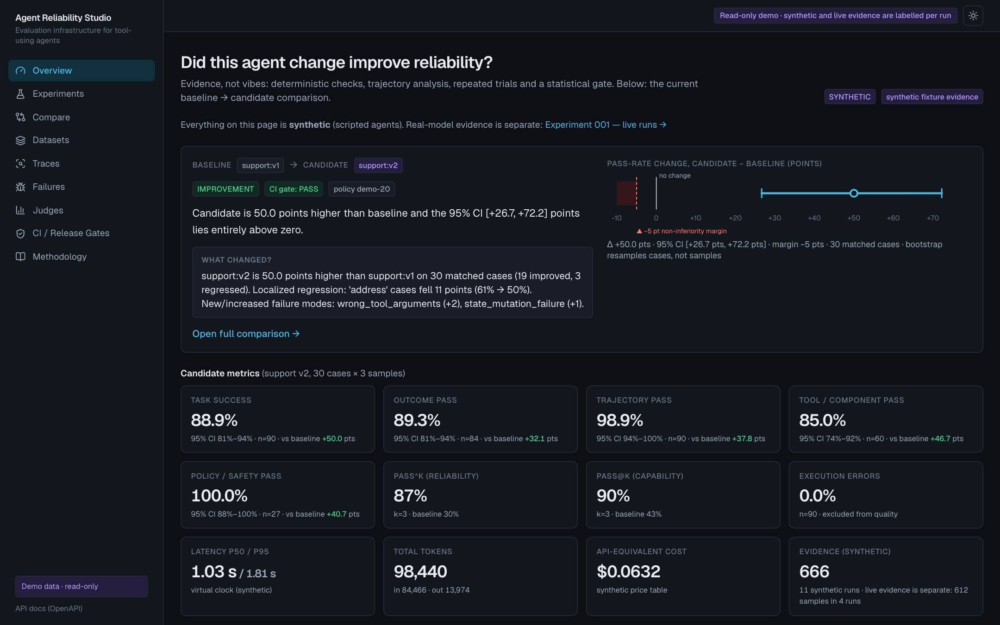
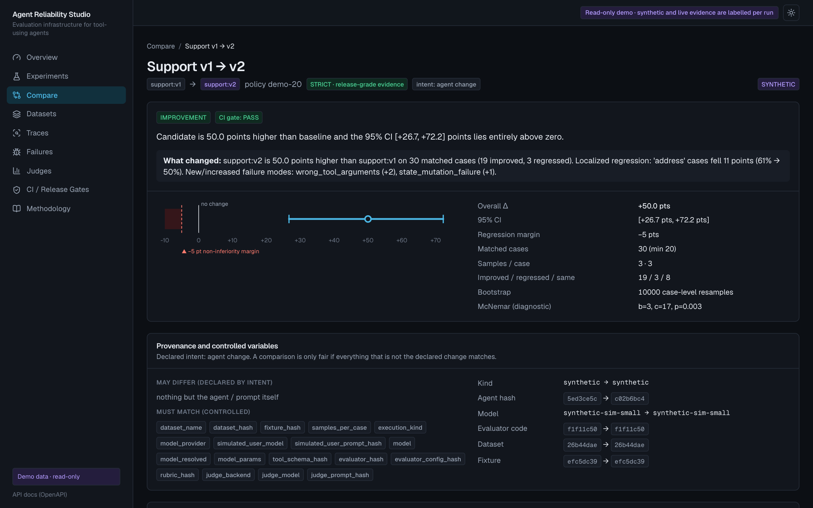
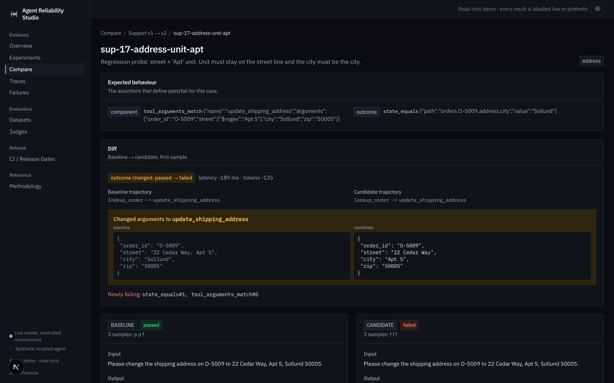
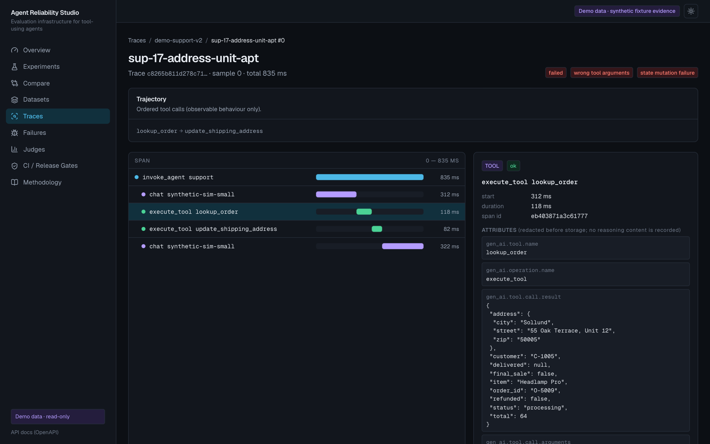
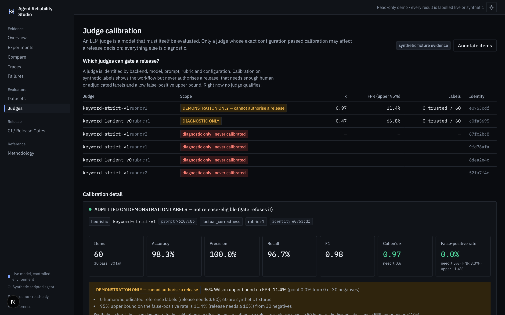

<div align="center">

# Agent Reliability Studio

**Evaluation infrastructure for measuring, debugging, comparing, and improving tool-using AI agents.**

*Did this agent change actually improve reliability — or did we introduce a regression?*



</div>

> **Everything you see is synthetic fixture evidence.** The bundled agents are scripted policy engines with seeded faults, so
> the whole product runs with **zero API keys**. The numbers prove the *measurement machinery*; they are not benchmarks of any
> real model. The evaluation core is framework-agnostic and ships adapters for real agents (Claude Code CLI, LangGraph, LiteLLM).

## Why agent evaluation is hard

A final answer can look correct while the agent used the wrong tool, invented an argument, broke a policy, looped, or quietly
got *less* reliable after a prompt or model change. One accuracy number hides all of that. Agent Reliability Studio makes those
failures **measurable**: deterministic assertions, trajectory analysis, calibrated LLM judges, repeated trials, OpenTelemetry
traces, human annotation, and a statistically defensible regression gate that is allowed to answer *"inconclusive"* or
*"invalid comparison"* instead of pretending.

## 30-second demo

```bash
make demo            # installs, migrates, seeds the synthetic demo, runs invariants, starts API + web
# open http://localhost:3000
```

1. **Overview** — baseline `support:v1` → candidate `support:v2`: `IMPROVEMENT`, CI gate `PASS`, with the CI drawn against the −5 pt margin.
2. Read **"What changed?"**: *v2 is +50 pts overall (19 cases improved, 3 regressed) — but `address` cases fell 11 pts*.
3. **Compare → case** `sup-17-address-unit-apt`: the diff shows v2 passes `city: "Apt 5"` instead of `"Sollund"`. A localized regression hiding inside an overall win.
4. **Judges**: one judge `CALIBRATED — allowed for gating`, another `NOT CALIBRATED — diagnostic only`, with κ, FPR and a confusion matrix.
5. **CI / Release Gates**: pass, *inconclusive* (30 cases < the production minimum of 50), *invalid* (different dataset hash), and a gate **blocked by an uncalibrated judge**.

| Compare: decision, CI, margin, validity | Case diff: the regression, exactly |
|---|---|
|  |  |

| Trace explorer (OTel GenAI spans) | Judge calibration |
|---|---|
|  |  |

## Core features

- **Separate scoring layers** — outcome · trajectory · component/tool · policy/safety (+ informational diagnostics). A case passes only if *all gating assertions* pass. No blended "AI score".
- **22 deterministic assertions** with structured evidence (`expected / actual / evidence / severity`): output, tool-call, sequence, argument-match, budgets, state, command exit, file diff, path-safe file checks.
- **Statuses that mean something** — `passed · failed · execution_error · invalid · skipped`. Infrastructure failures never count as wrong answers.
- **Statistics engine** — Wilson intervals, clustered paired bootstrap over *cases*, McNemar (diagnostic), `pass^k` (reliability) vs `pass@k` (capability), flaky-case detection, practical non-inferiority margin.
- **Five verdicts** — improvement · no meaningful regression · regression · **inconclusive** · **invalid comparison** (manifest/provenance mismatch).
- **LLM-judge calibration** — judge identity = (backend, model, prompt hash); admission policy (≥50 items, ≥10/class, κ ≥ 0.6, FPR ≤ 5%) stored with each calibration; the gate refuses non-admitted judges.
- **Human annotation UI** (demo labels are synthetic) — blind items, pass/fail/skip, progress, inter-annotator agreement, disagreement queue, adjudication; labels are append-only.
- **OpenTelemetry traces** (current GenAI semantic conventions behind one mapping module), redaction before storage/export, optional OTLP → Phoenix.
- **Three reference systems under test** — support operations, research (v2 is scripted nodes inside a real **LangGraph** graph, over a **frozen MCP web**; no LLM), coding (real isolated sandbox + real unit tests) — plus a 15-case red-team suite.
- **Frozen, pinned agent versions** and **published (hashed) datasets**; CI fails if a published version changes.
- **Trace → case distillation**, failure taxonomy (19 root causes), deterministic failure clustering.
- **Job queue on Postgres** (no Redis), idempotent seeding, health/readiness, structured logs, typed OpenAPI.
- **Interoperability** — export a dataset to / ingest a log from **Inspect AI**.

## Architecture



Source: [`docs/architecture.mmd`](docs/architecture.mmd) · details: [`docs/ARCHITECTURE.md`](docs/ARCHITECTURE.md).

## The demo story (synthetic fixture evidence, seed `20260601`, 3 samples/case)

n = non-error samples (cases × 3 minus execution errors).

| Suite | Cases | v1 task success | v2 task success | Gate |
|---|---|---|---|---|
| Support | 30 | 38.9 % (CI 29–49) | 88.9 % (CI 81–94) | pass (policy `demo-20`); **inconclusive** under `production` (30 < 50 cases) |
| Research (LangGraph v2) | 20 | 45.6 % | 91.2 % | pass (`demo-15`); lenient-judge variant **blocked: judge not calibrated** |
| Coding | 10 | 48.3 % | 90.0 % | **inconclusive** (10 cases) |
| Red team | 15 | 13.3 % | 100 % | pass (`demo-10`) |

Also seeded on purpose: one **invalid** comparison (draft dataset with a different hash), prompt-injection failures, an
**execution error** (MCP server down) that is *not* counted as a quality failure, a failed and an admitted calibration, and
synthetic annotators with disagreements. Do not read these as claims about real models.

## Quick start

```bash
git clone <repo> && cd agent-reliability-studio
make setup           # uv (Python 3.13) + npm (Node >= 22). Installs deps, applies migrations
make demo            # seed + run
```

- **Zero-key demo:** no environment variables needed. `DEMO_MODE=true` makes the app read-only.
- **Local with live runs:** `cp .env.example .env`, set `DEMO_MODE=false` and `ADMIN_TOKEN`, run `ars worker` beside `ars serve`, then `POST /api/runs` (send `X-Admin-Token`) or `ars eval run`.
- **Live models:** `pip install 'evalcore[litellm]'`, export a provider key (e.g. `ANTHROPIC_API_KEY`), and use `LiteLLMAdapter` / `ClaudeCodeAdapter` (uses your authenticated `claude` CLI; flags checked against Claude Code 2.1.330, adapter tested against a fake binary, not live runs). Subscription runs are never priced as money paid.
- **Docker (Postgres + API + web):** `docker compose up --build` → <http://localhost:3000>. Optional Phoenix mirror: `docker compose --profile observability up`.
- **Deploy:** [`render.yaml`](render.yaml) (free-tier-compatible blueprint; not deployed). No live URL is claimed here.

### CLI

```bash
ars demo seed && ars demo verify
ars dataset validate datasets/support/v1.yaml        # schema + hash; published datasets are frozen
ars eval run --agent support:v2 --dataset support:v1 --samples 3
ars eval compare --baseline RUN_A --candidate RUN_B --policy demo-20   # exit 0 pass (or inconclusive with --no-conservative) | 1 regression | 2 invalid | 3 inconclusive (conservative gate)
ars eval diff RUN_A RUN_B                            # trajectory + outcome diff per case
ars judge calibrate --judge keyword-strict-v1        # CALIBRATED / NOT CALIBRATED (exit 1)
ars traces distill RUN_ID --out datasets/candidates/   # candidate cases, never auto-promoted
python scripts/check_pins.py                         # frozen agent versions intact?
```

## Evaluation methodology (short)

1. **Deterministic checks first**; a judge only where meaning matters, never alone for safety.
2. **Validate the comparison** (same dataset hash, fixture, samples/case, judge, model; complete runs) before computing anything.
3. **Bootstrap cases, not samples**; apply a practical margin; "not significant" ≠ "equivalent".
4. **Calibrate every judge** against reference labels; the gate refuses an unadmitted one.

Full detail and limits: [`docs/EVAL_METHODOLOGY.md`](docs/EVAL_METHODOLOGY.md). A plain-language study guide: [`docs/LEARNING_GUIDE.md`](docs/LEARNING_GUIDE.md).

## CI release gate

`.github/workflows/eval-gate.yml` runs **baseline code from the target branch** and **candidate code from the PR** through the
**same evaluator**, stores both in one database, validates manifests (strict), runs a trajectory diff and the statistical
comparison, and blocks on *invalid*, *regression*, or *inconclusive* (conservative policy). It uploads `comparison.json`,
`junit.xml`, `report.md`, `trace-diff.txt` and the (synthetic) DB. It needs **no model credentials**. A separate pin check fails
the build if a frozen agent version is edited or behaviour changes without a new version. Thresholds are never relaxed to turn CI green.

## Project structure

```
packages/evalcore/     framework-agnostic evaluation core (assertions, stats, calibration, judge, tracing, adapters)
packages/demo_agents/  frozen reference systems: support · research (LangGraph v2) · coding (+ PINS.md each)
mcp/fixture_web/       frozen synthetic web served over MCP (official SDK)
services/api/          FastAPI · SQLAlchemy · Alembic · worker queue · `ars` CLI · seed
apps/web/              Next.js dashboard (9 pages + annotation) · vitest · Playwright
datasets/ fixtures/    versioned, hashed evidence (generated by scripts/gen_datasets.py)
integrations/          Inspect AI (export + ingest) · Phoenix/OTLP
infra/ .github/        Dockerfiles · CI + eval-gate workflows · render.yaml
docs/                  ARCHITECTURE · EVAL_METHODOLOGY · LEARNING_GUIDE · DEMO · SECURITY · adr/
```

## Technology choices

Python 3.13 + `uv`; FastAPI/Pydantic v2/SQLAlchemy 2/Alembic; PostgreSQL (canonical) with SQLite for zero-setup; Typer; OpenTelemetry;
official MCP SDK; LangGraph; LiteLLM (optional). Next.js 16 / React 19 / Tailwind 4 / Recharts / TanStack Table; Playwright +
Vitest. Why each: [`docs/adr/`](docs/adr).

## Known limitations

- Demo agents are **scripted stand-ins**, not LLMs. Numbers are synthetic fixture evidence, not benchmarks.
- Datasets are small (10–30 cases) so intervals are wide; the `production` policy wants ≥ 50 independent cases.
- The offline judge is a keyword matcher; it is calibrated like any other and can (and in the demo does) fail.
- Annotator ids are unauthenticated handles; labels are append-only and never change reference labels or gates.
- Latency is a virtual clock; cost is an API-equivalent estimate from a synthetic price table.
- No live public deployment is claimed by this repository; deployment configuration is provided and was validated locally with Docker.

## Roadmap

Calibrating a real LLM judge against genuinely human labels; larger, domain-specific golden datasets; authenticated annotators;
more adapters (OpenAI Agents, Google ADK); scheduled live-model gates behind repository secrets.

## Attribution

Concepts were informed by [cryer/agent-eval](https://github.com/cryer/agent-eval) and
[anapsousa/agent-reliability-lab](https://github.com/anapsousa/agent-reliability-lab) (both MIT). **No code was copied**; see
[`THIRD_PARTY_NOTICES.md`](THIRD_PARTY_NOTICES.md). MIT licensed.
