# Architecture



Source for the diagram: [`architecture.mmd`](architecture.mmd).

## Components and boundaries

| Component | Responsibility | Must not |
|---|---|---|
| `packages/evalcore` | Domain models, 24 assertions, scoring layers, statistics, calibration, judge, manifest + comparison provenance validation, tracing/redaction, taxonomy, trajectory diff, distillation, adapters (incl. the live Claude Code harness) | import FastAPI/SQLAlchemy/web code |
| `packages/demo_agents` | Frozen reference systems under test: three **scripted** agents (support, research, coding) with the `Runtime` harness (virtual clock, OTel spans, seeded fault injection), and the **live** `live_research` agent (a prompt + the real CLI harness) | contain evaluation logic |
| `mcp/fixture_web` | Deterministic, read-only synthetic web (corpus-v1: 29 pages for the scripted agents; corpus-v2: 83 pages for the live experiment, selected by `FIXTURE_CORPUS`) served by the **official MCP SDK** | touch the internet |
| `services/api` | REST API, SQLAlchemy models, Alembic migrations, job queue + worker, `ars` CLI, idempotent seed | duplicate logic between API/CLI/worker (they share `app/services/*`) |
| `apps/web` | Next.js dashboard; typed client generated from OpenAPI; **runtime `/api` proxy** | call the API with a build-time URL |
| `integrations/*` | Inspect AI export/ingest; Phoenix/OTLP mirror | become a dependency of the core |

## Data flow of one evaluation run

```
dataset YAML ──load_and_validate──▶ hash ──sync_dataset──▶ dataset_versions + eval_cases (FROZEN if published)
agent spec "support:v2" or "live:research:v2?model=haiku" ──registry.resolve──▶ ResolvedAgent (adapter, execution_kind, provider, resolved model, hashes, price table) ──▶ agent_versions
create_run ─▶ runs + manifest (dataset/fixture/judge/model + resolved model/execution_kind/evaluator code hash/agent config/seed/git…) + manifest_hash; run_type is DERIVED from the resolved agent, never chosen by the caller ─▶ run_executions (queued)
worker claims job (atomic UPDATE, lease token) ─▶ for each (case, sample_index):
      adapter.run(case) ─▶ AgentResult (tool calls, tokens, latency, state, spans — redacted)
      evaluate_all(assertions) + trajectory checks (+ judge if admitted) ─▶ SampleResult(status, labels)
      persisted: samples · assertion_results · spans · failure_labels      (resume-safe: unique(run, case, sample_index))
finalize_run ─▶ summary (layer rates + Wilson CI, pass^k, pass@k, latency p50/p95, tokens, cost) + failure_clusters
create_comparison(intent) ─▶ validate_pair (strict|exploratory; controlled variables per intent; coverage) ─▶ paired cluster bootstrap + end-to-end sensitivity ─▶ decision ─▶ create_gate(release=True) ─▶ ci_gate_decisions
```

## Database (20 tables)

`agents · agent_versions · datasets · dataset_versions · eval_cases · runs · run_executions · samples · spans · assertion_results ·
failure_labels · failure_clusters · judge_configs · calibration_sets · calibration_items · calibration_runs · human_annotations ·
comparisons · ci_gate_decisions · distilled_candidates`. JSON(B) is used only for genuinely free-form payloads (span attributes, case
definitions, manifests, comparison results). Indexes cover run lookups, agent/version joins, `(run, status)`, trace lookup, failure
label filtering, and timestamp sorting. Lists are paginated; serializers use joined loads (no N+1).

## Jobs

`run_executions` is the queue and carries a **lease**. `claim_next` is one atomic compare-and-set `UPDATE … WHERE id=? AND status='queued'` that
also issues a random `lease_token` and `lease_expires_at`. A **heartbeat thread with its own database session** extends the lease with
`UPDATE … WHERE lease_token=?` (ownership validated by the database), so a long sample - a live model call can take minutes - cannot starve it.
`recover_stale` is a rowcount-checked `UPDATE` per expired execution (two recoverers cannot both re-queue the same job), bounded by `MAX_ATTEMPTS`.
**Fencing:** before every write batch the worker re-checks its lease and every terminal state change is conditional on the token, so a stale worker
cannot commit over a newer attempt; samples also carry a unique `(run_id, case_id, sample_index)` key and finished samples are skipped, so a resumed job never
duplicates work. Verified on SQLite and PostgreSQL with concurrent-claim, concurrent-recovery, slow-job, takeover and bounded-retry tests. This is a
single-database lease, **not** a distributed-consensus guarantee (small check-then-write window; see `docs/SECURITY.md`). No Redis/Celery.

## Live agents

`services/api/app/registry.py` resolves an agent *spec* into an adapter, whether synthetic (`support:v2`) or live (`live:research:v1?model=haiku`), so both go
through the **same** run/score/compare pipeline. The live harness (`evalcore.adapters.ClaudeCodeToolAgent`) runs the user's own authenticated Claude Code
CLI with only the fixture MCP tools, in an isolated, budget- and timeout-limited process, and turns the CLI's real `stream-json` events into spans (no
synthesized tool calls, no thinking blocks). Provenance records requested **and resolved** model; alias drift invalidates comparisons. Live execution is
operator-only (CLI or admin token); the public demo only *displays* published, sanitized live evidence (`evidence/experiments/…`, re-imported by the seed and
**re-compared with the same evaluator code**).

## Tracing

`evalcore.tracing.TraceRecorder` creates real OpenTelemetry SDK spans with a **virtual clock** (reproducible timings) and copies redacted
attributes into `SpanRecord`s. Attribute names come from `evalcore/semconv.py` (the single GenAI-convention mapping; `gen_ai.operation.name`
∈ `invoke_agent | chat | execute_tool | retrieval`, `gen_ai.provider.name`, `gen_ai.usage.*`, `gen_ai.tool.*`). Exporters (e.g. OTLP→Phoenix)
only ever see redacted data. The DB span table is the source of truth for the dashboard.

## API and frontend

FastAPI exposes typed read endpoints (overview, runs, samples, traces, comparisons, case diffs, failures, judges, calibration, annotation,
gates, datasets) plus admin-only mutations. `ars openapi` exports the spec; `openapi-typescript` generates `lib/api-types.ts`. Server components
fetch directly from `API_URL`; the browser calls same-origin `/api/*`, which a route handler forwards to `API_URL` **at runtime** (one build runs anywhere).

## Deployment topologies

- **Local:** SQLite file, `make dev`.
- **Compose:** Postgres + API (loopback-published) + web; Phoenix behind `--profile observability`.
- **Render:** free-tier-compatible blueprint (`render.yaml`): free Postgres (expires after 30 days), free API *web* service in read-only demo mode, free web tier. Private services have no free tier. Not deployed by this repo's tooling. The API seeds the synthetic demo on first start (idempotent).

## Trust boundaries in CI

The eval gate measures baseline and candidate with the **trusted base checkout's** evaluator, datasets, fixtures and scripts; only the agent package comes from the PR
(`docs/CI.md`). The pin checker reads pins from the git baseline, not the PR tree. Honest limit: PR agent code still shares a Python process with the evaluator.
